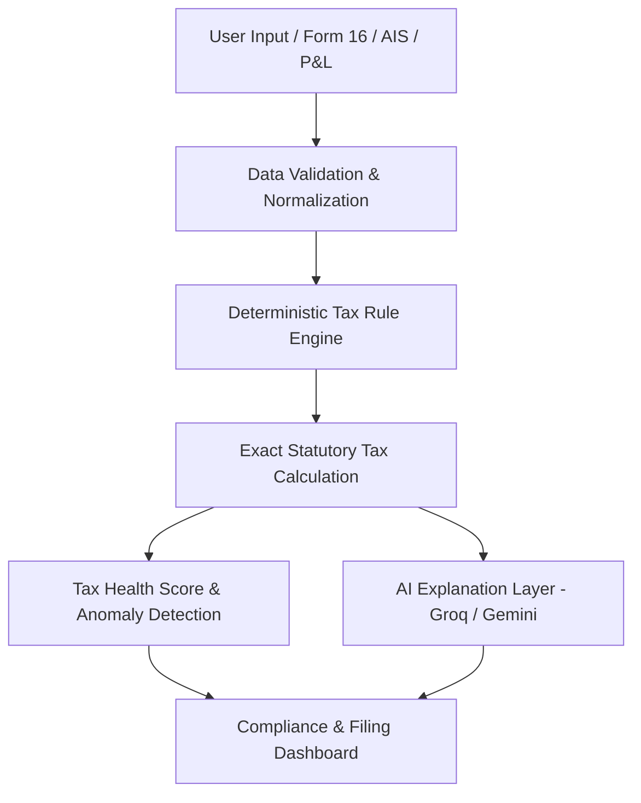

# FiscalAura — AI-Powered Tax Intelligence & Compliance Platform

FiscalAura is an institutional, production-grade Indian Tax Intelligence & Compliance Platform designed for salaried professionals, job-switchers, freelancers, and investors (FY 2024-25 / AY 2025-26).

It bridges the gap between raw tax calculation and full e-filing readiness—delivering multi-employer Form 16 consolidation, AIS / TIS / 26AS cross-audit reconciliation, deterministic tax regime optimization, capital gains analysis, and context-aware AI advisory.

---

## 🏛️ Architecture & Core Principles

### 1. Deterministic Calculation Guarantee
> **Engineering Mandate**: Financial calculations **never** depend on an LLM.

- Tax slabs, 87A rebates, standard deductions, cess, surcharges, and Section 234 interest liabilities are evaluated via a **pure, deterministic Go calculation engine** (`backend/services/taxengine`).
- **AI Role**: LLMs (Gemini / Groq) serve exclusively as an **explanation layer** to interpret results, synthesize multi-source discrepancies, and provide plain-language guidance.



---

## 🚀 Key Modules & Capabilities

### 1. Multi-Employer Form 16 Intelligence (`/form16`)
- **The Problem**: When employees switch jobs mid-year, both employers independently apply the standard deduction and initial 0% tax slabs, leading to massive year-end tax shortfalls.
- **The Solution**: Consolidates 2 to 5 Form 16s, deduplicates standard deductions to apply exactly once, recalculates aggregate slab jumps, and computes net self-assessment tax due before filing.

### 2. AIS / TIS / Form 26AS Cross-Reconciliation (`/reconciliation`)
- Cross-audits self-declared financial data against official Income Tax Department feeds:
  - Bank Savings & Term Deposit Interest (Section 80TTA/TTB vs AIS)
  - Corporate Dividend Receipts
  - SFT Securities Turnover
  - Form 26AS TDS Credits
- Classifies entries as `MATCHED` (🟢), `DIFFERENCE` (🟡), or `UNREPORTED` (🔴) with actionable CPC notice prevention advice.

### 3. Capital Gains & Tax-Loss Harvesting (`/capital-gains`)
- Standardized parser adapters for **Zerodha**, **Groww**, **Upstox**, and generic trade sheets.
- Computes **STCG (Section 111A @ 20%)** and **LTCG (Section 112A @ 12.5% above ₹1.25L exemption)** under Finance Act 2024.
- Educational tax-loss harvesting tips identify unrealized portfolio losses to offset realized capital gains before March 31.

### 4. Advance Tax & Section 234A/B/C Schedule (`/advance-tax`)
- Interactive quarterly milestone tracker (June 15, Sept 15, Dec 15, March 15).
- Precise interest penalty computations for filing delays (234A), advance tax default < 90% (234B), and quarterly installment deferments (234C).

### 5. Context-Aware AI Tax Copilot (`/copilot`)
- Powered by dual failover (Groq Qwen 2.5 / Google Gemini).
- Context-aware: Passes live calculation results, Form 16 totals, and AIS discrepancies into the prompt context so answers never invent numbers.

### 6. Official Tax Assessment Statement PDF (`/reports`)
- Print-ready and downloadable formal Tax Assessment Statement featuring FiscalAura institutional branding, income breakdown, regime comparison, verification checks, and statutory disclaimers.

---

## 🛠️ Tech Stack

- **Frontend**: React 18, Vite, TypeScript, Tailwind CSS, shadcn/ui, TanStack Query, Recharts.
- **Backend**: Go 1.22+, Chi Router, CORS, Supabase REST/Storage client.
- **Tax Engine**: Custom Go package (`backend/services/taxengine`) with 100% test coverage.
- **AI Infrastructure**: Unified `AIClient` with automated failover between Groq and Gemini.
- **Database & Auth**: Supabase PostgreSQL with Row Level Security (RLS) and encrypted document storage.

---

## 💻 Local Development Setup

### Prerequisites
- Node.js 18+ and npm
- Go 1.22+
- Supabase Project credentials

### 1. Environment Configuration

#### Frontend (`.env` in repository root):
```dotenv
VITE_SUPABASE_PROJECT_ID="your_supabase_project_id"
VITE_SUPABASE_PUBLISHABLE_KEY="your_supabase_anon_key"
VITE_SUPABASE_URL="https://your_supabase_project.supabase.co"
VITE_API_URL="http://localhost:3001"
VITE_MOCK_SUPABASE=false
```

#### Backend (`backend/.env`):
```dotenv
SUPABASE_URL=https://your_supabase_project.supabase.co
SUPABASE_ANON_KEY=your_supabase_anon_key
GEMINI_API_KEY=your_gemini_api_key
GEMINI_MODEL=gemini-3.5-flash-lite
GROQ_API_KEY=your_groq_api_key
GROQ_MODEL=qwen/qwen3.6-27b
PORT=3001
FRONTEND_URL=http://localhost:8081
MOCK_SUPABASE=false
```

### 2. Run the Application

#### Start the Go Backend:
```bash
cd backend
go mod download
go test -v ./services/taxengine/...
go run main.go
```
The backend starts on `http://localhost:3001`.

#### Start the Frontend:
```bash
npm install
npm run dev
```
Open `http://localhost:8081` in your browser.

---

## 🧪 Testing

Run backend deterministic tax engine unit tests:
```bash
cd backend
go test -v ./services/taxengine/...
```

Run frontend build verification:
```bash
npm run build
```

---

## 🔒 Security & Compliance
- **Data Isolation**: Multi-tenant database protected by PostgreSQL Row Level Security (RLS).
- **Zero API Key Leakage**: Groq and Gemini API keys are strictly retained server-side.
- **Statutory Notice**: FiscalAura provides informational computations in accordance with the Indian Income Tax Act, 1961 and does not replace certified professional legal or chartered accountancy representation.
